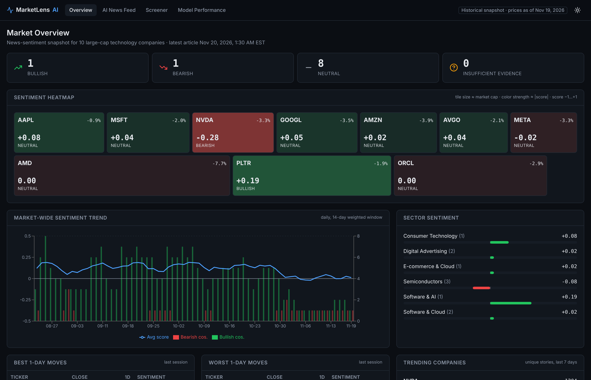
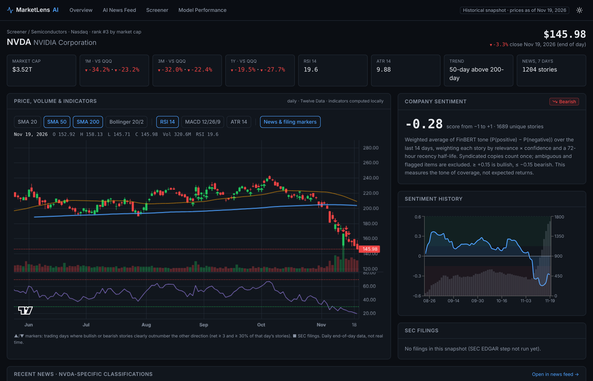
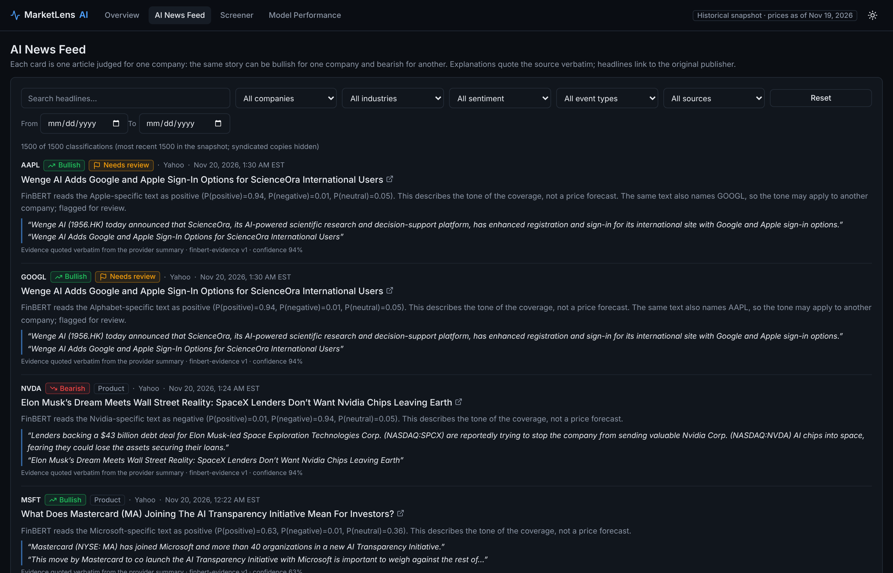
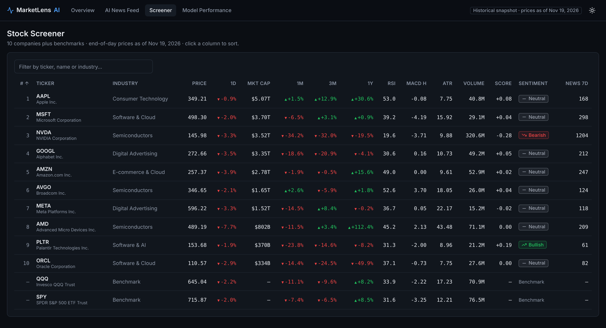
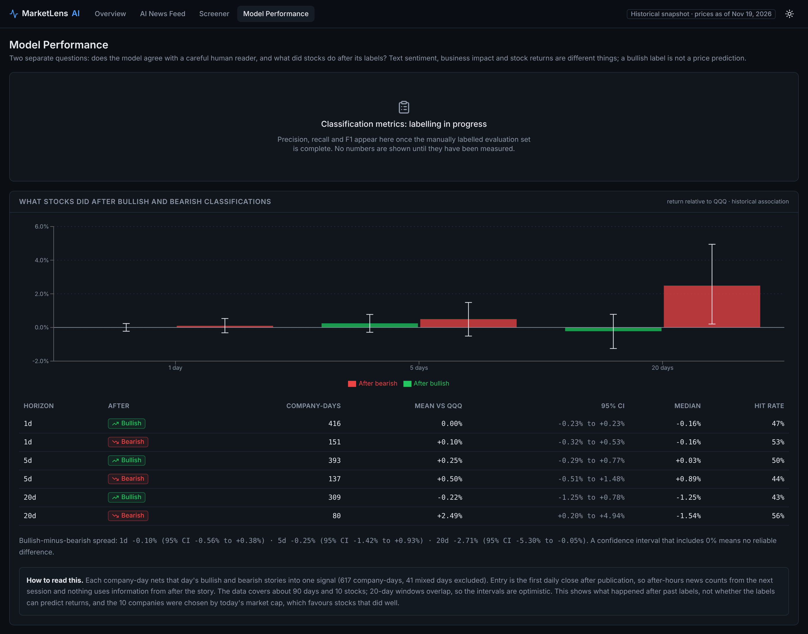
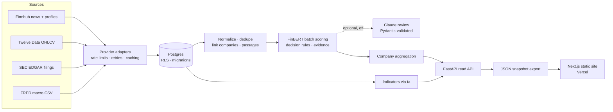

# MarketLens AI

**Company-level news sentiment for large-cap technology stocks, with every call linked to its
source and explained in the source's own words.**

MarketLens reads financial news, works out which companies each article is actually about,
and classifies the article separately for each of them as **bullish, bearish, neutral or
insufficient evidence**. The same story can be good for one company and bad for another
("Broadcom wins the chip order AMD lost"). Results are shown in a dashboard with price charts,
technical indicators, a filterable news feed, a screener and an honest model-evaluation page.

> Educational portfolio project. Sentiment labels describe the tone of news coverage. They are
> not investment advice or price predictions.



| Company detail | AI news feed |
|---|---|
|  |  |
| **Screener** | **Model performance** |
|  |  |

## What it does

- **Per-company classification.** Articles are linked to companies by ticker and alias, and each
  company is judged only on the sentences that name it.
- **Source-grounded explanations.** Each label shows FinBERT's probabilities and up to two
  sentences quoted verbatim from the article summary, plus a link to the original publisher.
  Nothing is paraphrased, so nothing can be invented.
- **Never forced.** Low-confidence or close calls become `insufficient_evidence`; a directional
  call on a passage that also names another tracked company is flagged for review.
- **Company-level scores.** A transparent, versioned aggregation (recency, relevance and
  confidence weighting; syndicated copies counted once; no look-ahead).
- **Market context.** Candlestick charts with SMA 20/50/200, Bollinger Bands, RSI, MACD and ATR
  computed locally, news and SEC filing markers, and returns relative to QQQ.
- **Honest evaluation.** A blind, hand-labelled evaluation set (precision, recall, macro F1,
  confusion matrix, baselines, bootstrap confidence intervals) and an analysis of returns after
  bullish and bearish days, clearly labelled as historical association.

## Snapshot at a glance (data as of 19–20 Nov 2026)

| | |
|---|---|
| Companies | 10 (NVDA, AAPL, MSFT, GOOGL, AMZN, META, AVGO, AMD, ORCL, PLTR) + QQQ, SPY benchmarks |
| Raw news items pulled (90 days) | 52,768 → 35,265 unique |
| Articles that name a tracked company | 19,972 (257 syndicated copies linked to originals) |
| Company-level predictions | 24,325: 36% neutral, 30% bullish, 23% bearish, 11% insufficient evidence |
| Daily price bars | 3,816 (~15 months incl. indicator warm-up) |
| Returns after bullish vs bearish company-days | No reliable difference at 1 or 5 days; bearish days were followed by +2.5% vs QQQ at 20 days (n = 80). Descriptive only — see the Model Performance page. |
| Classification metrics | Published on the Model Performance page once the hand-labelled set is complete |
| Operating cost | $0 (free API tiers, local FinBERT, static hosting; Claude review off) |

## How it works



Heavy ML never runs on a web request: the pipeline runs once, the API's responses are exported
to JSON, and the website is a static build of that snapshot. Details:
[`docs/ARCHITECTURE.md`](docs/ARCHITECTURE.md) · methodology: [`docs/METHODOLOGY.md`](docs/METHODOLOGY.md).

## Tech stack

| Layer | Tools |
|---|---|
| Frontend | Next.js 16 (static export), TypeScript (strict), Tailwind CSS 4, shadcn/ui-style components, TradingView Lightweight Charts, Recharts |
| Backend | Python 3.13, FastAPI, SQLAlchemy Core, Pydantic, pandas, NumPy, `ta`, slowapi |
| ML | Hugging Face Transformers, ProsusAI/FinBERT, PyTorch, scikit-learn; Anthropic Claude API (optional) |
| Data | PostgreSQL 16 (Supabase-compatible migrations, row-level security) |
| Quality | pytest (79 tests), Playwright (13 end-to-end tests, desktop + phone), ruff, GitHub Actions, gitleaks |
| Hosting | Vercel (static site) |

## Repository layout

```
backend/marketlens/   providers/ pipeline/ models/ evaluation/ api/ db/ jobs/
backend/tests/        unit, database, API and pipeline tests
frontend/             Next.js app, components, e2e tests, snapshots/{real,demo}
supabase/migrations/  versioned up/down SQL with RLS and least-privilege roles
config/universe.csv   company universe (SEC CIKs verified)
tools/labeler/        blind labelling page used to build the evaluation set
docs/                 plan, architecture, methodology, universe, deployment
```

## Run it

### Just the website (no keys, no database)

```bash
cd frontend
npm ci
npm run build              # uses the committed real snapshot; SNAPSHOT=demo for synthetic data
npx serve out
```

### The full pipeline

Requires Python 3.11+, PostgreSQL 16, and free API keys for Finnhub and Twelve Data in a local
`.env` (copy `.env.example`; never commit `.env`). SEC EDGAR needs a contact User-Agent.

```bash
cd backend
python -m venv .venv && source .venv/bin/activate
pip install -e ".[dev,ml]"
python -m marketlens.db.migrate up
python -m marketlens.jobs.seed
python -m marketlens.jobs.pull --snapshot 2026-11-20      # prices, news, profiles, filings, macro
python -m marketlens.jobs.indicators
python -m marketlens.jobs.news --snapshot 2026-11-20      # FinBERT scoring (CPU is fine)
python -m marketlens.jobs.aggregate
python -m marketlens.jobs.evaluate [--labels ../data/eval/labels_v1.csv]
python -m marketlens.jobs.export --out ../frontend/snapshots/real
uvicorn marketlens.api.app:app                            # API docs at /api/docs
```

Synthetic demo snapshot (wipes the given database):

```bash
python -m marketlens.jobs.demo_snapshot --db postgresql+psycopg://localhost/marketlens_demo --out ../frontend/snapshots/demo
```

### Tests

```bash
cd backend && TEST_DATABASE_URL=postgresql+psycopg://localhost/marketlens_test pytest
cd frontend && npm run build && npx playwright test
```

## Security

- No secrets in the repo, the browser bundle or logs: keys come from environment variables
  only, settings use `SecretStr`, logs are redacted, gitleaks runs on every push, and a
  Playwright test scans the built site for anything key-like.
- The public site is static; no API keys or database exist at runtime.
- The API (when run) uses a read-only database role, row-level security, input validation, rate
  limiting and a token-protected admin endpoint. Claude review can't be triggered by users and
  has a daily cap.
- Strict security headers on the deployed site (CSP, frame denial, nosniff).

If a credential is ever exposed: revoke it at the provider immediately, issue a new one, update
the environment secrets, and remove it from git history.

## Limitations

- One 90-day snapshot of 10 companies; not a live service (the production path is documented in
  [`docs/IMPLEMENTATION_PLAN.md`](docs/IMPLEMENTATION_PLAN.md)).
- FinBERT reads short provider summaries, not full articles, and makes visible mistakes; the
  evaluation page measures how often.
- Company linking uses tickers and aliases, not named-entity recognition.
- The universe is chosen by today's market cap (survivorship bias in any return analysis).
- SEC filings were not included in this snapshot.

## Data and attribution

News via Finnhub (headlines, short summaries and links to the original publishers; full articles
are never stored). Prices via Twelve Data (end-of-day). Macro series via FRED. Used under the
providers' free, non-commercial tiers for an educational portfolio project.

## Documentation

- [`docs/IMPLEMENTATION_PLAN.md`](docs/IMPLEMENTATION_PLAN.md) – plan, costs, schema, security, acceptance criteria
- [`docs/ARCHITECTURE.md`](docs/ARCHITECTURE.md) – components, data flow, design decisions
- [`docs/METHODOLOGY.md`](docs/METHODOLOGY.md) – labels, explanations, aggregation, evaluation
- [`docs/UNIVERSE_METHODOLOGY.md`](docs/UNIVERSE_METHODOLOGY.md) – company selection
- [`docs/DEPLOYMENT.md`](docs/DEPLOYMENT.md) – publishing the site on Vercel
